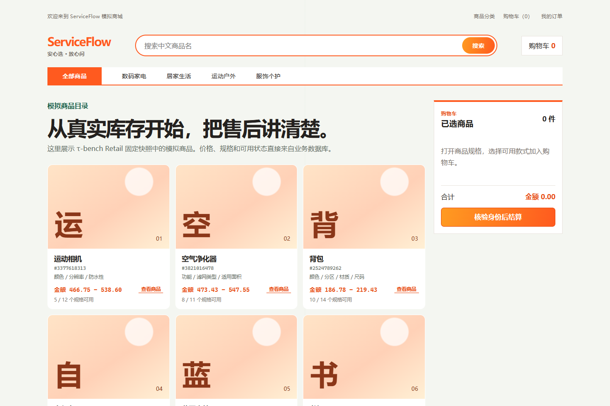
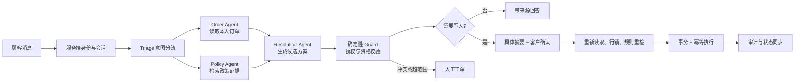
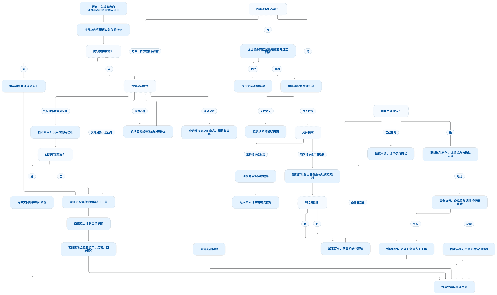
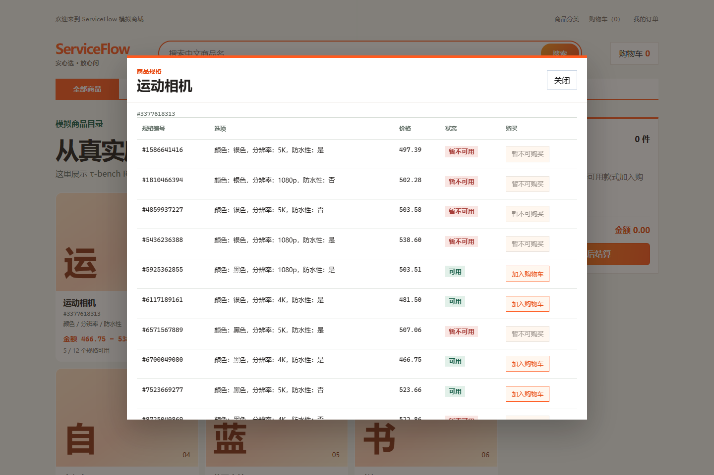

# ServiceFlow｜可信多 Agent 智能售后平台

一个面向电商售后的全栈 AI 工程项目：模型负责理解与规划，服务端负责身份、授权、规则、确认和写入，让 Agent 不只是“会聊天”，还能在可控边界内完成真实业务操作。

> 当前状态：阶段 0–5 已完成。项目使用模拟业务数据，不连接真实支付、退款或物流系统；默认 Mock/本地规则模式无需付费 LLM Key。



## 30 秒了解项目

- **完整产品闭环**：中文模拟商城、订单客服、管理后台、开发者追踪页共用 PostgreSQL 业务数据库。
- **安全写操作**：取消和退货必须经过身份校验、具体方案、客户明确确认、执行前重检、事务写入、幂等与审计。
- **可恢复、可接管**：LangGraph PostgreSQL checkpoint、失败恢复、工单系统和人工双向沟通。
- **可验证**：单元、集成、真实 PostgreSQL、并发和 Playwright 浏览器测试；评测结果不回避多 Agent 未胜出的事实。

适合作为 **AI 应用开发、Python 后端、Agent 工程或全栈实习** 方向的作品集。它重点展示工程约束与验证，不把“用了多 Agent”本身当作成果。

## 它和普通聊天机器人有什么不同

普通聊天机器人可能根据 Prompt 直接声称“已经取消订单”。ServiceFlow 把理解和执行拆开：



LLM 可以提出意图、计划和解释，但不能自行决定客户身份、订单归属或写入结果。操作成功只以数据库事务结果为准。

<details>
<summary><strong>查看完整业务流程图（点击展开）</strong></summary>

下图覆盖内容安全、身份绑定、咨询分流、政策检索、订单读写、明确确认、人工接管和结果留存。点击图片可查看原始尺寸。

[](docs/images/serviceflow-business-flow.png)

</details>

## 产品界面

上方商城首屏展示公开商品目录；商品规格、实时可售状态与价格直接读取业务数据库：



截图来自本地真实运行界面，只包含公开商品数据。顾客资料、订单明细、操作员令牌和原始评测轨迹不会提交到仓库。

启动后可访问：

- `/store`：商城、身份核验、本人订单和订单独立客服线程
- `/admin`：工单、审批、人工接管和审计
- `/developer`：Agent 节点、工具调用、耗时、错误和业务关联
- `http://127.0.0.1:8000/docs`：FastAPI OpenAPI

## 关键工程能力

| 方向 | 已实现内容 |
|---|---|
| 身份与授权 | 会话绑定唯一顾客；所有订单读取和写入均由服务端校验归属 |
| 写操作安全 | 具体操作摘要、明确确认、确认绑定、过期处理、执行前状态重检 |
| 并发安全 | PostgreSQL 事务、行锁、订单版本、数据库唯一幂等键 |
| 故障恢复 | PostgreSQL checkpoint、执行租约、分类重试、确认后中断恢复 |
| RAG | 政策分块、来源引用、关键词回退、pgvector 路径与注入防护 |
| 人工协作 | 工单状态机、审批边界、客服与顾客双向消息、人工执行仍不能绕过客户确认 |
| 可观测性 | `trace_id`、节点耗时、工具结果、Provider、Token 字段和审计事件 |
| 公平评测 | 单/多 Agent 使用共享安全边界；开发集与冻结保留集分离 |

更多设计说明见 [架构文档](docs/ARCHITECTURE.md)、[项目规格](docs/PROJECT_SPEC.md) 和 [数据与 RAG](docs/DATA_AND_RAG.md)。

## 已验证结果

以下是仓库内已有验收记录，不是预计值：

| 验证范围 | 实际结果 | 证据 |
|---|---:|---|
| 后端完整回归（含真实 PostgreSQL 随机 schema） | **269 passed，0 failed，0 skipped** | [阶段 5 报告](docs/PHASE5_REPORT.md) |
| 前端 Vitest | **43 passed** | [阶段 4.5D 报告](docs/PHASE4_5D_REPORT.md) |
| Chromium + FastAPI + PostgreSQL | **11 passed** | [阶段 4.5D 报告](docs/PHASE4_5D_REPORT.md) |
| 自建可靠性轨道 | **10/10** | [评测说明](docs/EVALUATION.md) |
| 冻结保留集：单 Agent | **51/120（42.50%）** | [保留集报告](docs/PHASE5B_HOLDOUT_REPORT.md) |
| 冻结保留集：多 Agent V3 | **45/120（37.50%）** | [保留集报告](docs/PHASE5B_HOLDOUT_REPORT.md) |

最后一次后端完整验收记录于 2026-11-22，耗时 101.68 秒；Ruff、报告一致性检查和测试 schema 清理同时通过。

### 对评测结果的解释

独立保留集没有证明多 Agent 优于单 Agent：配对差值为 −5 个百分点，McNemar 精确双侧 `p=0.238`。这既不能支持“多 Agent 更好”，也不足以断言它确定更差。

该结果使用保留的上游任务和 DeepSeek 自定义语义 Judge，**不是官方默认 τ-bench 分数**。项目保留这一负结果，因为它比只展示开发集最好成绩更能说明评测纪律。详细口径见 [阶段 5 总结](docs/PHASE5_REPORT.md)。

## 5 分钟本地启动

需要 Docker Desktop、Docker Compose 和 Python 3.12。首次运行会从固定上游 commit 下载最小模拟数据文件；真实密钥不得写入仓库。

```powershell
# 1. 创建本地配置，替换其中两个 <...> 占位符
Copy-Item .env.example .env.phase4

# 2. 获取并校验固定版本的 τ-bench Retail 模拟数据
python -m scripts.fetch_tau_retail

# 3. 启动数据库并显式导入模拟快照
docker compose up -d --build db
docker compose --profile tools run --rm seed

# 4. 启动 API 与前端
docker compose up -d --build api frontend
docker compose ps
```

访问 <http://127.0.0.1:5173/store>。默认模式使用本地规则和 Mock Provider，不需要 LLM Key。完整环境准备、测试和清理方式见 [本地开发指南](docs/LOCAL_DEVELOPMENT.md)。

## API 安全写入示例

身份核验后，在某笔本人订单的客服线程请求取消：

```http
POST /api/v1/multi-agent/chat
X-Session-Id: <verified-session-id>
Content-Type: application/json

{"message":"这个订单不要了","order_id":"<owned-order-id>"}
```

服务端先返回待确认方案，不修改订单：

```json
{
  "task_status": "pending_confirmation",
  "pending_confirmation": {
    "order_id": "<owned-order-id>",
    "proposed_parameters": {"reason": "no longer needed"},
    "summary": "取消订单 <owned-order-id>；原因：不再需要"
  },
  "final_response": "请核对操作内容；确认请回复‘确认’。订单尚未修改。"
}
```

只有客户随后明确确认，且服务端重新读取订单、锁定记录并再次通过规则校验，才会执行写入。完整演示步骤见 [3 分钟演示脚本](docs/DEMO.md)。

## 技术栈

- **后端**：Python 3.12、FastAPI、Pydantic、SQLAlchemy、LangGraph
- **数据**：PostgreSQL 16、pgvector、JSONB、事务与行级锁
- **前端**：React 19、TypeScript、Vite、TanStack Query
- **测试**：pytest、Ruff、Vitest、ESLint、Playwright
- **运行**：Docker Compose、Nginx

## 仓库导航

```text
backend/app/       FastAPI、领域服务、Agent 编排与执行边界
frontend/src/      商城、客服、管理后台与开发者追踪页
tests/             单元、API、PostgreSQL、并发和故障测试
scripts/           数据获取、种子、E2E 与评测脚本
docs/              架构、阶段验收、演示与开发指南
reports/           脱敏汇总结果；原始轨迹被 Git 忽略
```

- [3 分钟演示脚本](docs/DEMO.md)
- [本地开发与测试](docs/LOCAL_DEVELOPMENT.md)
- [架构说明](docs/ARCHITECTURE.md)
- [评测方法](docs/EVALUATION.md)
- [阶段 5 最终报告](docs/PHASE5_REPORT.md)
- [完整阶段记录](TASKS.md)

## 已知边界

- 这是模拟售后平台，不执行真实支付、退款、邮件或物流操作。
- 本地身份核验和操作员 Token 是演示机制，不是生产级 IAM。
- 默认关键词政策检索可离线运行；向量检索和外部模型属于可选配置。
- 上游 τ-bench 原始数据、任务和源码不提交到本仓库；获取脚本固定 commit 并校验 SHA256。
- 原始评测轨迹、`.env*`、数据库卷和模拟客户派生隐私输出不进入 Git。

## 数据与许可边界

项目代码采用 [MIT 许可证](LICENSE)。τ-bench Retail 文件由本地脚本按固定版本获取，遵循其自身许可证与来源记录；本项目的 MIT 许可证不对第三方数据或代码重新授权。详见 [数据导入说明](docs/DATA_IMPORT.md)。
