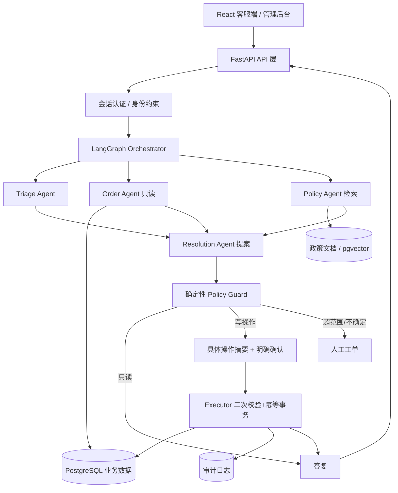
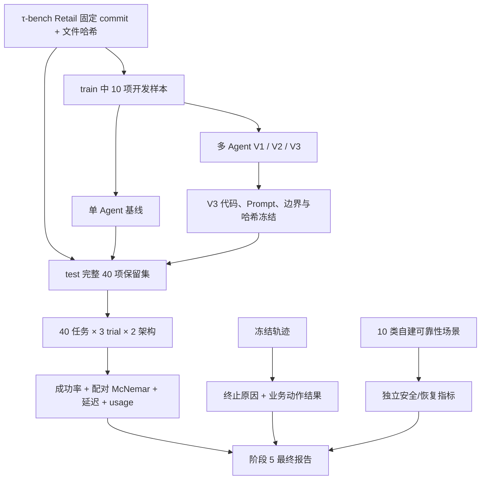

# 技术架构与工作流

## 1. 架构层次



`Supervisor / Orchestrator` 可以先用确定性 LangGraph 路由节点；专业节点也不强制都使用不同 LLM。必须在最终报告区分 **Agent（LLM决策）** 与 **普通服务/规则节点（代码执行）**。

## 2. Agent职责和工具白名单

| Agent/节点 | 输入 | 允许工具 | 输出 | 禁止行为 |
|---|---|---|---|---|
| Triage Agent | 当前消息+有限会话上下文 | 意图枚举/结构化解析 | intent、entities、缺失信息 | 直接查询或修改订单 |
| Order Agent | 已认证user_id、订单号 | get_own_orders、get_order、get_product | 结构化订单事实 | 修改数据库/跨用户读取 |
| Policy Agent | 业务类型、政策版本 | get_policy_section / RAG search | 政策引用、待检查条件 | 决定授权通过 |
| Resolution Agent | 订单事实+政策证据 | generate_proposal / draft_reply | proposed_action、说明、缺失信息 | 直接写数据库 |
| Policy Guard（代码） | 提案+身份+最新订单状态 | 数据库查询+规则函数 | allow/deny/requires_confirmation | 依赖模型陈述放行 |
| Executor（代码） | 已确认操作+幂等键 | 事务写入 | 最终业务状态+审计 | 绕过Policy Guard |

## 3. LangGraph Shared State（草案）

```python
class ServiceState(TypedDict, total=False):
    session_id: str
    thread_id: str
    authenticated_user_id: str | None
    user_message: str
    intent: str
    extracted_entities: dict
    order_snapshot: dict
    policy_evidence: list[dict]
    proposed_action: dict | None
    proposal_id: str | None
    user_confirmation: bool | None
    approval_status: str
    operation_id: str | None
    tool_results: list[dict]
    error_code: str | None
    next_step: str
```

这些是建议字段，不代表实际 Pydantic 模型已存在。对话流保存应有会话隔离和可配置的隐私保留策略。

## 4. 写操作状态机

```text
NEW → INFO_GATHERING → PROPOSED → WAITING_USER_CONFIRMATION
                              ├─用户拒绝→ CANCELLED
                              ├─超时/内容变化→ EXPIRED
                              └─明确确认→ REVALIDATING
                                            ├─失败→ REJECTED / HUMAN_REVIEW
                                            └─通过→ EXECUTING
                                                      ├─成功→ SUCCEEDED
                                                      └─失败→ FAILED / RETRYABLE
```

设计原则：proposal包含订单号、商品ID、动作类型、目标字段、政策版本、订单版本及有效期；确认必须绑定proposal_id。执行服务端对同一operation_id建立唯一索引，用事务保证不会重复写入。数据库内容变化后让用户重新确认新的提案。

## 5. 预期API（设计稿，可按实现调整）

| 方法 | 路径 | 功能 |
|---|---|---|
| POST | `/api/v1/sessions` | 建立客服会话 |
| POST | `/api/v1/sessions/{id}/verify` | 模拟身份核验 |
| POST | `/api/v1/chat` | 用户发言/调用工作流 |
| GET | `/api/v1/orders/{id}` | 获取**本人**订单 |
| POST | `/api/v1/operations/{id}/confirm` | 确认具体写操作 |
| GET | `/api/v1/tickets` | 管理人员获取工单 |
| POST | `/api/v1/tickets/{id}/handoff` | 人工接管 |
| GET | `/api/v1/traces/{trace_id}` | 查询执行轨迹（开发环境） |
| GET | `/api/v1/health` | 存活检查 |

## 6. 计划中的仓库结构

```text
serviceflow/
├─ AGENTS.md / README.md / TASKS.md / CODEX_START_HERE.md
├─ docs/                        # 设计文档
├─ data/
│  ├─ raw/tau2/                # 官方原始文件（不提交仓库）
│  └─ processed/               # 清洗中间文件（不提交仓库）
├─ scripts/
│  ├─ fetch_tau_retail.py
│  ├─ inspect_tau_retail.py
│  └─ seed_database.py
├─ backend/
│  ├─ pyproject.toml
│  ├─ app/
│  │  ├─ main.py
│  │  ├─ api/                  # 路由与DTO
│  │  ├─ agents/               # LangGraph状态与节点
│  │  ├─ domain/               # 规则/实体/操作提案
│  │  ├─ services/             # 数据访问、执行器、RAG
│  │  ├─ repositories/         # SQL存储
│  │  ├─ integrations/tau2/    # 上游适配器，与生产模式隔离
│  │  └─ observability/       # traces/cost
│  └─ tests/
├─ frontend/                    # React+TS (阶段4)
├─ tests/                       # e2e / 数据/评测
└─ docker-compose.yml
```

## 7. 版本边界

- 只从官方上游指定 commit 导入 **Retail 数据与工具定义**；我们的业务 API 可以与上游不同。
- 在正式基准评测时，用 `integrations/tau2/` 把自己的Agent接到上游工具和消息协议，**不得用自建数据库的简化规则冒充官方基准**。
- 官方 Retail 政策要求一轮最多一次工具调用，评测适配器应遵守上游协议；演示产品交互可独立优化。

## 8. 阶段 5 冻结评测管线



评测任务正文、参考动作和评分条件只存在于隔离的上游评测环境与离线 5C 分析，不进入线上 Agent Prompt、产品会话或业务数据库。`reports/results.csv` 保存逐次聚合结果；包含模拟客户明细的原始轨迹位于被 Git 忽略的 `reports/raw/`。官方任务自定义 Judge 与自建可靠性轨道分别报告，不能合并成功率。
