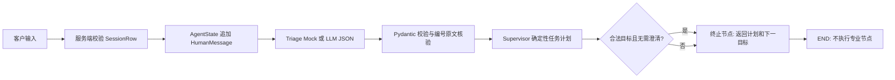

# 阶段 2.2：Triage 与 Supervisor 验收报告

日期：2026-11-02（Asia/Shanghai）。仓库根目录为当前 Codex 工作区，Python 包名 `serviceflow`。本阶段只接入意图识别、确定性规划和安全终止；Order、Policy、Resolution、Guard、Executor 均未执行。

## 职责与流程



`TriageResult` 包含主要意图、全部意图、明确提及的订单/商品编号、动作、参数、缺失信息、澄清标记、模型置信度参考值和简短分类依据。置信度没有统计校准。Mock 使用有限关键词和编号规则；真实模式复用现有 `OpenAICompatibleProvider.complete(..., tools=[])`，要求 JSON，经 Pydantic 严格校验，最多两次尝试。服务端验证编号必须来自用户原文或先前待澄清任务，并保留订单号的 `#` 前缀；拒绝模型额外授权字段。模型异常与格式失败只输出脱敏错误码。

Supervisor 是普通 Python，不增加 LLM 调用。`TaskPlan` 记录任务 ID、意图、目标、输入依赖、前置任务和 `pending/ready/blocked` 状态。查询先计划 Order；政策咨询计划 Policy；写请求计划订单查询、政策证据、确定性 Guard、Resolution 提案、明确确认及 Executor。复合请求共用订单查询任务，按依赖顺序排列。`completed/failed` 是后续可用状态，本阶段不设置成功状态。缺订单号或未核验身份时返回澄清；未知请求、非法目标与超过六次路由时安全终止。计划目标不等于已运行节点。

## 共享状态与会话

在阶段 2.1 `AgentState` 中新增 `triage_result`、`task_plan`、`missing_information`、`task_status` 和 `trace`。图节点的增量在返回前经 `apply_agent_update` 校验，`messages` 和 `trace` 按 reducer 追加；任务计划在每轮替换，避免重复堆积。入口每轮从 `SessionRow` 读取用户身份，而非信任模型或客户端；身份核验后由服务端绑定身份，保留同会话的待澄清意图。订单摘要和提案在切换订单时清除。所有业务数据读取与写入仍须由后续服务端工具执行，本阶段没有调用它们。

多轮状态存于进程内 `SessionStateStore`，由服务端 `session_id` 索引；`thread_id` 与该 ID 相同。进程重启、跨进程部署和状态清理尚未实现，属于阶段 3 持久化范围。调试入口仅返回本轮轨迹和计划，不向模型提供完整用户数据库、密钥或 τ-bench 参考答案。

## 调试 API

新增 `POST /api/v1/debug/plan`，请求头 `x-session-id: <已创建的会话ID>`，请求体示例：

```json
{"message":"帮我看看订单123能不能退货，如果可以就申请退货"}
```

响应包含 `input`、`thread_id`、`triage`、`task_plan`、`next_agent`、`missing_information`、`task_status`、`current_task`、`trace`、`final_response`。示例关键字段如下；真实任务计划还包括政策、Guard、提案、确认和执行的待处理步骤：

```json
{"triage":{"intent":"complex_request","intents":["order_query","return_order"],"order_id":"123"},"next_agent":"order","task_status":"planned","task_plan":[{"task_id":"order-lookup","target_agent":"order","status":"ready"}],"final_response":"Plan prepared; next target: order. No order or policy work has been executed."}
```

上例为**字段摘录**，不是完整 JSON 响应；未经核验的会话还会返回 `identity_verification` 缺失项，`next_agent` 为 `end`。若先问“查询订单状态”，再在同一会话补充“123”，系统保留原任务 ID 并更新订单编号。现有 `/api/v1/chat` 和阶段 1.5 基线适配器未改。

## 文件变更

- 新增 `backend/app/multi_agent/models.py`、`triage.py`、`supervisor.py`、`workflow.py`。
- 扩展 `backend/app/multi_agent/state.py`；在 `backend/app/main.py` 新增独立调试路由。
- 新增 `tests/test_phase22_triage.py`、`tests/test_phase22_workflow.py`、`tests/test_phase22_api.py`。
- 更新 `README.md`、`TASKS.md` 和本报告；阶段 2.1 原有未提交修改保留。

## 验证、真实模型与限制

完整测试命令：`.venv312/Scripts/python -m pytest -q -rs -p no:cacheprovider -o faulthandler_timeout=30 --basetemp=.pytest_phase22_acceptance2`，需在允许 Windows 本地 loopback socket 的环境运行 TestClient。实际结果：**88 项收集，84 passed、0 failed、4 skipped，2.17 秒**。跳过原因分别为 3 项缺少运行中的 PostgreSQL/`TEST_DATABASE_URL`，1 项当前 `.venv312` 缺少 `tau2`。ruff 命令：`.venv312/Scripts/python -m ruff check backend scripts tests`，通过。现有单 Agent 和 FastAPI API 测试包含在本次通过项中。

Mock 和脚本化 Provider 测试不调用付费网络。真实模型使用现有 `.env` 中的 DeepSeek 配置、`deepseek-v4-flash`、temperature 0，对合成输入做少量烟测：政策咨询识别为 `policy_inquiry`；带 `#W0000000` 的订单查询最终识别为 `order_query` 并保留完整编号。首次模型输出曾遗漏 `#`，促使增加原文编号核验与回归测试；该首次输出不计为成功。此烟测未调用数据库、写工具或官方评分器，未记录 Token/成本，不能推断总体准确率。

当前缺口：专业节点未实现，因此任务只被规划，不能执行查询或售后写操作；Mock 词法覆盖有限；真实模型格式仍可能失败并进入安全错误；内存状态不能跨进程恢复。与阶段 2.1 相同，当前环境的 PostgreSQL/Docker 和 `.venv312` 中的 `tau2` 缺失使相关既有集成测试跳过。后续阶段须按 `TaskPlan` 依赖接入 Order、Policy、Guard/Resolution/Executor，且每次业务访问重做服务端身份、归属、政策硬规则和确认校验。
