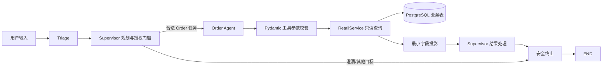

# 阶段 2.3：Order Agent 只读查询验收报告

日期：2026-11-02（Asia/Shanghai）。项目根目录为当前 Codex 工作区，Python 包名 `serviceflow`。本阶段只实现只读 Order Agent；不执行取消、修改、退换货、政策检索或其他专业 Agent。

## 流程与职责



Order Agent 接收 `TaskPlan` 中 `target_agent="order"` 且 `status="ready"` 的任务。当前任务和编号已明确时使用确定性工具选择，不为简单查询增加 LLM 调用；Triage 的真实 LLM 模式仍可负责语言理解。工具白名单为 `get_customer_orders`、`get_order_details`、`get_order_status`、`get_order_items`、`get_order_logistics`、`get_product_details`。`OrderToolCall` 通过 Pydantic 严格验证名称、编号格式和参数组合；非法/写入工具名被拒。每轮最多调用 2 个只读工具，不向模型提供 SQL 执行入口。

私人订单工具委托 `RetailService.orders/order`，由服务端再次读取会话身份、按订单 `source_user_id` 校验归属；不存在与他人订单统一返回 `order_not_found`。商品详情采用 `RetailService.product(..., public=True)`：仍需有效会话，但可在未核验客户身份时读取公开商品信息；原有 `product` 默认行为保持需核验。状态中的 `identity_verified` 仅用于路由，不能代替服务端校验。任何 LLM/选择器指定的错误订单号仍受服务端归属检查。

## 数据投影与共享状态

读取结果先转换为严格的 `OrderQueryResult`，只包含实际数据库字段：订单列表的编号/状态；详情的编号、状态、商品项（源订单价格快照）和 `fulfillments`；商品的名称、当前变体价格/可用性。固定 Retail 数据中的 `tracking_id` 实际为**字符串列表**，与 `item_ids` 一起原样返回；没有预计送达时间或实时物流轨迹。地址、客户 ID、支付历史和原始完整订单 JSON 不进入调试结果与共享状态。

`AgentState.order_data` 按任务 ID 保存本轮结构化投影；`order_context` 只保存单笔订单的编号和状态，列表/商品查询时可为空。`tool_results` 保存工具名、成功/失败和脱敏错误码；`trace` 记录节点、所选工具和参数，不记录原始客户对象。查询成功将对应 Order 任务标为 `completed`；失败标为 `failed`，整个流程 `query_failed`；未实现的 Policy/Resolution/Guard 等任务仍为 `pending`/`blocked`。查询后图只经过一次 Supervisor 结果处理并安全终止，不回跳 Order 节点。

## API 示例

沿用 `POST /api/v1/debug/plan` 和现有 `x-session-id`。已核验会话查询：

```json
{"message":"查询订单o状态"}
```

合成测试数据下响应的关键字段：

```json
{"triage":{"intent":"order_query","order_id":"o"},"task_status":"queried","next_agent":"end","task_plan":[{"task_id":"order-lookup","target_agent":"order","status":"completed"}],"tool_results":[{"tool":"get_order_status","status":"ok","code":null}],"order_context":{"order_id":"o","status":"pending"},"order_data":{"order-lookup":{"kind":"status","source":"business_database","order_id":"o","status":"pending"}}}
```

此为字段摘录，真实响应还包括 `input`、`thread_id`、缺失信息、`state`、`trace` 和 `final_response`。`trace` 中 Order 节点包含 `arguments:{"order_id":"o"}`。未核验时私人订单请求返回 `clarification`、`identity_verification` 和空 `order_data`；有效会话可查询公开商品。现有 `/api/v1/chat` 单 Agent 基线未修改。

## 实际验证

测试输入使用手写合成数据和固定 Retail 快照；真实数据库测试在随机 `phase23_*` schema 中导入源快照、验证后删除，`phase23_*` 残留数量实测为 **0**。新测试覆盖订单列表、详情、状态、商品项、价格/变体、已有物流字段、无订单、未核验、跨客户订单、非法参数、错误工具、数据库异常、两轮补号、复合任务、工具次数和只读无审计写入。

| 环境与命令 | 结果 |
|---|---|
| `.venv312/Scripts/python -m pytest -q -rs -p no:cacheprovider -o faulthandler_timeout=45 --basetemp=.pytest_phase23_full312`，设置 `TEST_DATABASE_URL` | **107 passed, 1 skipped**；跳过的是该环境未安装 `tau2` 的适配器测试 |
| `.venv_tau/Scripts/python -m pytest -q -rs -p no:cacheprovider -o faulthandler_timeout=45 --basetemp=.pytest_phase23_final2`，设置同一测试库 URL | **108 passed, 0 failed, 0 skipped**；含之前跳过的 3 项 PostgreSQL 测试和 1 项官方适配器测试 |
| `.venv312/Scripts/python -m ruff check backend scripts tests` | 通过 |

PostgreSQL 场景 A：已核验客户读取本人订单的源状态与 fulfillment 字段；B：未核验请求没有订单结果；C：其他客户查询同一订单得到 `order_not_found`；D：同会话第二轮补订单号后完成查询。测试还核对订单版本未变、提案和审计表为空。官方适配器仅补跑原有测试，没有修改 τ-bench 数据或评分器。

真实 LLM 使用现有 `deepseek-v4-flash` 配置，对**合成**订单号 `#W0000000` 做一次分类烟测：返回 `order_query`、保留合成编号，`requested_action="check_status"`。已将该动作别名映射到最小的 `get_order_status` 工具，并以脚本化 Provider 验证后续本地查询。真实模型调用与 PostgreSQL 实际数据查询分别验证；未把固定 Retail 订单号发给外部模型，未声称完成真实模型与该数据的联合端到端测试。Token/费用未记录，不给出估计值。

## 文件与限制

新增 `backend/app/multi_agent/order_tools.py`、`order_agent.py` 和 `tests/test_phase23_order.py`、`test_phase23_api.py`、`test_phase23_postgres.py`。增量修改 `multi_agent/models.py`、`state.py`、`triage.py`、`supervisor.py`、`workflow.py`、`backend/app/service.py`、阶段 2.2 随路由演进的测试、`README.md`、`TASKS.md`；此前未提交的阶段 2.1/2.2 修改保留。

自动审批曾拒绝将固定 Retail 订单号发送到外部 LLM 的烟测，理由是当前授权未涵盖该数据向该目的地外发；随后采用合成编号的真实 LLM 分类和隔离 PostgreSQL 查询分别验证。Order Agent 当前只做确定性工具选择；复杂模糊指代可能需要后续澄清或受限模型选择。多轮状态仍是进程内调试状态，重启后不恢复。Policy、Resolution、Guard 和 Executor 尚未接入，复合任务只完成已授权的 Order 子任务。

本阶段修改的 Python 文件均通过 `ruff format --check`；全仓库格式检查仍指出 5 个未在本阶段修改的历史文件，未为通过格式检查而改动它们。全仓库 `ruff check` 通过。
