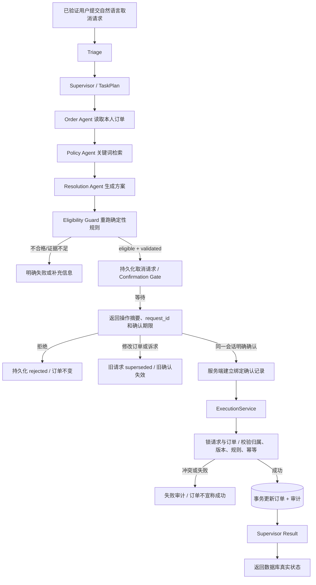

# 阶段 2.5C 验收报告：订单取消端到端 Multi-Agent 闭环

日期：2026-11-04（Asia/Shanghai）

## 1. 范围、结论与未满足项

本阶段只整合订单取消：自然语言请求经过既有 Triage、Supervisor、Order、Policy、Resolution 和确定性 Eligibility Guard，生成持久化待确认请求；第二轮由同一已验证会话确认后，非 LLM Execution Node 调用 2.5B `ExecutionService` 完成事务写入和审计。修改、退货和换货仍不能执行。

代码闭环、FastAPI 多轮测试、旧接口封堵、演示脚本和文档均已完成。Docker 恢复后，新增 PostgreSQL 两轮测试、隔离演示和全套回归全部实际通过：**169 passed、0 failed、0 skipped**，Ruff 通过。随机 schema 内真实完成一笔确认后的取消，未确认反例保持 pending，测试和演示结束后 `phase25c_*` schema 残留为 0。最终验收目标已达到。

## 2. 业务流程



## 3. 实际新增与修改文件

- `backend/app/multi_agent/conversation.py`：新增统一多轮会话协调器、确定性确认/拒绝解析、旧请求替换、当前任务投影和基础指标。
- `backend/app/multi_agent/execution.py`：新增确认/拒绝挑战读取和 `supersede_request`；执行拒绝已替换请求。
- `backend/app/multi_agent/models.py`：执行请求状态加入 `superseded`。
- `backend/app/multi_agent/workflow.py`：规划响应输出错误列表；执行恢复在读取确认前先检查持久化请求终态。
- `backend/app/main.py`：新增 `/api/v1/multi-agent/chat` 与 `/api/v1/multi-agent/tasks/current`；版本更新为 0.2.7；禁用旧 HTTP 写入口。
- `tests/test_api.py`：旧 `/operations` 写入口改为 HTTP 410 回归。
- `tests/test_phase25c_api.py`：两轮成功、幂等重放、拒绝、修改订单号、改变诉求、过期、订单变化、会话隔离、未验证身份和旧 API 绕过测试。
- `tests/test_phase25c_postgres.py`：随机 PostgreSQL schema 中的完整两轮成功和未确认零写入测试；本轮真实运行通过。
- `scripts/demo_phase25c_cancel.py`：随机 schema 的成功/未确认对照演示，输出方案、证据、轨迹、指标、数据库状态和审计。
- `README.md`、`TASKS.md`、本报告：接口、迁移、结果和限制。

工作区原有阶段 2.2–2.5B 未提交文件没有被回退或重建。

## 4. AgentState 与多轮恢复

第一轮沿用 `run_turn` 和同一 `SessionStateStore`，传递 `current_task/task_status`、`task_plan`、Order Agent 的受限订单投影、Policy Agent 的来源片段、`ResolutionProposal`、`EligibilityResult`、`pending_action`、trace 和工具结果。资格通过后，协调器调用 `ExecutionService.prepare_cancel`，把返回的 `ExecutionRequestSummary` 写入 `AgentState.execution_request`，将 Confirmation 任务设为 blocked，并返回操作摘要、服务端挑战文本和 `request_id`。

第二轮不能根据聊天历史直接信任“确认”。协调器使用请求中的 `request_id` 和服务端 session 重新读取数据库请求，取得服务端生成的具体挑战，调用 `record_decision` 建立绑定用户、session、订单、动作、proposal ID、版本和摘要的确认记录，然后 `run_execution_turn` 从数据库重建必要的 proposal/eligibility/confirmation 上下文。只有 `bind_server_confirmation` 可设置受保护的 `user_confirmed`；普通 Agent 更新仍会因 `protected_state_field` 被拒绝。

持久化边界是执行请求、确认、幂等结果和审计。完整消息/图 checkpoint 仍在进程内；服务重启后可用 2.5B 的显式确认/执行 API 从数据库继续最小执行流程，但不承诺恢复完整聊天轨迹，这符合本轮“不开发完整工作流故障恢复”的限制。

## 5. 用户修改、拒绝、重复与并发变化

- 相同取消请求在待确认期内重复发送，只返回同一个 pending 请求，不创建无意义新方案。
- “拒绝”持久化 `ConfirmationRecord(decision=reject, status=rejected)`，AgentState 进入 `confirmation_rejected`，不调用执行节点。
- 用户修改订单号或改变诉求时，旧请求进入 `superseded`，有效确认记录会被 invalidated，并写 `request_superseded` 审计；旧请求再次执行返回 `execution_request_superseded`。
- 确认过期返回 `confirmation_expired`；订单在等待期间变化时，执行前 `row_version` 校验返回 `order_changed`。
- 成功后重复确认会读取 consumed 确认并返回原数据库结果，`idempotent_replay=true`；订单版本和 `execution_succeeded` 审计不重复增加。
- 两个会话竞争同一订单继续依赖 2.5B 的数据库请求锁、订单锁和 `row_version`。本轮没有改弱这些约束；其真实 PostgreSQL 并发结果已在 2.5B 验收，但本轮未重新运行。

## 6. 旧版 API 安全检查与迁移

开发前检查确认三个公开入口可进入阶段 1 legacy 路径：`POST /api/v1/operations`、`POST /api/v1/operations/{proposal_id}/confirm` 以及带 `proposal_id` 的 `POST /api/v1/chat`。旧服务有身份、归属、状态和 proposal 版本校验，但其布尔确认、旧审计和幂等语义不能满足 2.5B/2.5C 的可信确认绑定，因此不能继续作为公开取消写入口。

采用最小修复：三个 HTTP 写路径现在返回 HTTP 410；错误码为 `legacy_write_api_disabled_use_multi_agent` 或 `legacy_chat_write_disabled_use_multi_agent`。调用方迁移到 `/api/v1/multi-agent/chat`，或继续使用 2.5B 的 cancel-request/decision/execute 三步 API。回归测试先用内部阶段 1 服务创建 legacy proposal，再尝试两个 HTTP 确认路径，订单均保持 pending。

没有删除 `RetailService.propose/confirm`、查询型 `chat_once/live_chat` 或官方 τ-bench 适配器，以免破坏阶段 1 业务规则测试和单 Agent 对照。内部直接调用不等于生产认证入口；生产 FastAPI 已不暴露 legacy 取消执行。查询型 Baseline 回归通过。

## 7. API 与输出

- `POST /api/v1/multi-agent/chat`：提交自然语言消息；后续确认/拒绝可附同一 `request_id`。
- `GET /api/v1/multi-agent/tasks/current`：读取当前任务、TaskPlan、Order/Policy 上下文、方案、资格、待确认请求、执行结果和 trace。
- 2.5B 的请求查询、决策、执行、订单读取和审计 API 保持兼容。

会话响应包含 `task_status`、`request_id`、`pending_confirmation`、`resolution_proposal`、`eligibility_result`、`execution_result`、`failure_reason`、`task_plan`、当轮 trace、工具结果、最终回复和 `metrics`。指标记录节点数、工具调用数、总延迟、节点名称和 provider；本地 Mock 没有 Token 统计，明确返回 `token_usage=null`。

`/api/v1/multi-agent/chat` 本阶段强制使用 Mock Triage、关键词 Policy 和本地 Resolution，避免把完整订单或客户数据发给外部模型，也不依赖尚未真实验收的 pgvector。身份只来自 `x-session-id` 关联的服务端 `service_sessions.user_id`，请求体没有 `user_id` 或测试绕过字段。

## 8. 成功与失败案例

已实际通过的 SQLite/FastAPI 成功案例：

1. 已验证用户请求取消本人 pending 订单。
2. Order/Policy/Resolution/Guard 的状态与证据进入同一 AgentState。
3. 第一轮返回 `pending_confirmation`，读取订单仍为 pending。
4. 第二轮“确认”建立持久化确认并进入受控执行图。
5. 返回 `executed`，数据库订单为 cancelled，trace 为 Confirmation → Execution → Supervisor Result → Terminal。
6. 审计只有一次 `execution_succeeded`；重复确认返回幂等重放。

已实际通过的失败案例包括：未确认零写入、明确拒绝、其他会话盗用 request ID、未验证身份不产生执行请求、修改订单号使旧请求失效、中途改成查询、确认过期、等待期间订单版本变化、旧布尔确认和旧聊天确认均返回 410。2.5A/2.5B 既有回归继续覆盖已发货/已取消规则拒绝、Policy 空结果、非法 Resolution 参数、模型与硬规则冲突、数据库故障回滚、幂等键冲突和并发逻辑。

## 9. 数据库写入与审计验证

SQLite/FastAPI 测试实际验证：未确认和拒绝时订单状态保持 pending；成功确认后状态变为 cancelled、`row_version` 只增加一次；重复确认不新增成功审计；等待期间手工把订单推进为 processed 后，执行返回 `order_changed` 且状态保持 processed。审计事件包括 proposal、eligibility、confirmation、execution，以及本阶段新增的 `request_superseded`。

PostgreSQL 测试使用固定 τ-bench Retail `db.json` 导入随机 `phase25c_*` schema，成功路径实际得到 cancelled 和 `proposal_generated`、`eligibility_validated`、`user_confirmed`、`execution_succeeded` 四类审计；反例在未确认时保持 pending。演示脚本在随机 `phase25c_demo_*` schema 得到同样结果，并写出 `reports/phase25c_demo.json`。测试及演示均在 `finally` 删除表与 schema，随后查询 `pg_namespace` 得到 `phase25c_%` 数量为 0。

## 10. 测试命令与实际结果

已实际运行：

```powershell
.venv312/Scripts/python -m pytest tests/test_phase25c_api.py -q -p no:cacheprovider --basetemp=.pytest_phase25c_api
# 5 passed

.venv312/Scripts/python -m pytest tests/test_phase25b_execution.py tests/test_phase25b_api.py tests/test_api.py -q -p no:cacheprovider --basetemp=.pytest_phase25bc_regression
# 20 passed

$env:TEST_DATABASE_URL = (.venv312/Scripts/python -c "from app.config import Settings; print(Settings().database_url)")
.venv_tau/Scripts/python -m pytest tests/test_phase25c_postgres.py -q -rs -p no:cacheprovider --basetemp=.pytest_phase25c_pg
# 1 passed

.venv_tau/Scripts/python -m scripts.demo_phase25c_cancel --output reports/phase25c_demo.json
# success: pending -> cancelled；unconfirmed: pending

.venv_tau/Scripts/python -m pytest -q -rs -p no:cacheprovider -o faulthandler_timeout=45 --basetemp=.pytest_phase25c_full_pg
# 169 passed, 0 skipped

.venv312/Scripts/python -m ruff check backend scripts tests
# All checks passed!
```

首次尝试曾因 Docker 未启动而在建 schema 前连接超时；用户启动 Docker 后重新执行，以上 PostgreSQL 测试、演示和完整回归均成功。最终结果以成功重跑为准，没有忽略或改写失败断言。

## 11. Mock、真实 LLM 与已知问题

本轮没有调用真实外部 LLM。实际通过的是可重复 Mock Triage、关键词 Policy、本地 Resolution、真实业务规则以及 SQLite/PostgreSQL 事务链。因此可以声称 Mock + 真实 PostgreSQL 端到端已经验证，但不能声称真实 LLM 端到端已验证。外部数据发送审批没有被关闭或绕过。

已知限制与后续建议：

- 生产认证仍需安全 Cookie/Token、TLS、CSRF 防护、会话轮换和吊销；确认挑战不是第二因素。
- `SessionStateStore` 不支持跨进程完整会话恢复；后续可引入持久化 checkpointer，但不能用它替代业务幂等。
- `Base.metadata.create_all` 仍缺少正式 Alembic 迁移。
- 单库完全不可用时失败审计仍是 best effort；更强保证需要 outbox 或独立审计通道。
- 指标是进程内总延迟和调用计数，没有分节点耗时或真实 Token 成本。
- 本阶段不授权修改、退货或换货执行，也未开发人工审批、前端或阶段 2.6 基准实验。

本报告到此停止，不自动进入下一阶段。
