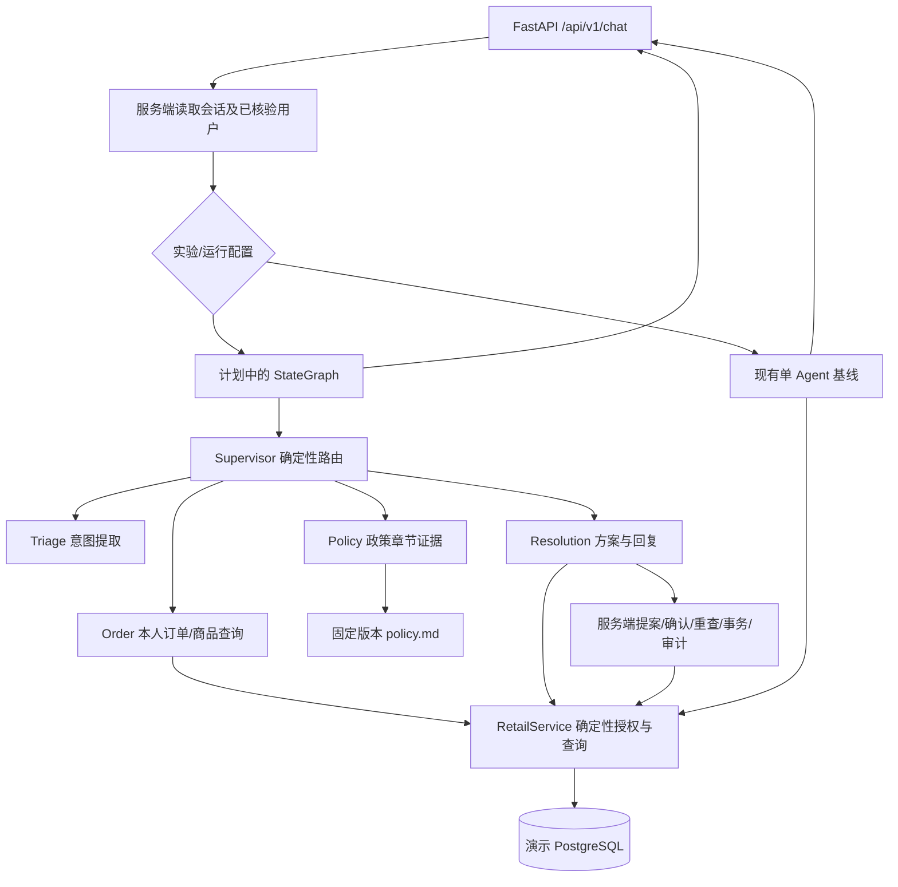

# 阶段 2.1：Multi-Agent 架构与共享状态契约

## 现状与边界

本仓库实际包名为 `serviceflow`，项目代码位于当前仓库根目录。现有 `app.agent` 是 Mock LangGraph 单 Agent，`app.live_agent` 是可替换 Provider 的真实 LLM 单 Agent；FastAPI `/api/v1/chat` 根据配置选择其中之一。`RetailService` 管理会话身份、本人订单查询、业务规则、操作提案、确认、事务和审计。阶段 1.5 已记录四个产品场景和官方固定 10 题的一次小样本运行；这些成绩不是多 Agent 的实验结果，也不足以证明多 Agent 优势。

本阶段只交付状态类型、初始化/更新函数和设计契约。下图为**后续实现目标**，图中专业节点、检索节点和多 Agent 路由均尚未实现。

## 共享状态

代码位于 `backend/app/multi_agent/state.py`。`AgentState` 是 LangGraph `StateGraph` 的 `TypedDict`；`new_agent_state` 返回独立、完整的初始值；`apply_agent_update` 对节点增量做严格类型和字段校验，返回深拷贝。LangGraph 1.2.19 下 `messages` 使用 `Annotated[list[AnyMessage], add_messages]`，同 ID 消息会替换、不同 ID 会追加；`tool_results` 与 `errors` 用列表相加归并。节点应返回增量，不能把旧列表再次作为新增项返回，否则会重复。

| 字段 | 类型 / 初值 | 用途与边界 |
|---|---|---|
| `messages` | `list[AnyMessage]` / `[]` | 当前会话消息；禁止放系统密钥或完整客户资料；跨轮历史需由服务端按会话加载。 |
| `session_id`, `thread_id` | `str` / 同一非空会话 ID | 会话隔离与未来 checkpointer 键；不得由节点改变。 |
| `user_id`, `identity_verified` | `str\|None`, `bool` / `None`, `False` | 服务端从 `SessionRow` 读取后注入；仅是路由提示，不能代替每次业务服务授权。 |
| `intent`, `current_task` | `str\|None` / `None` | 意图与当前任务标签；无可执行权限。 |
| `order_id`, `order_context` | `str\|None`, `OrderContext\|None` / `None` | 仅保留本人订单 ID、状态摘要；缺失订单时为 `None`，不得猜测订单事实。 |
| `policy_context` | `list[PolicyEvidence]` / `[]` | 文档来源、章节、版本、chunk ID、分数和短摘录；不作为授权结果。 |
| `policy_retrieval` | `SearchResult\|None` / `None` | 本轮政策查询、方法、Top-K、延迟与完整命中；仅用于调试和可溯源回答。 |
| `pending_action` | `PendingAction\|None` / `None` | 只存服务端已创建的 proposal ID、订单、动作和具体摘要；无原始支付资料。 |
| `user_confirmed` | `bool` / `False` | 只供服务端确认路径记录，Agent 不可更新；真实执行仍须绑定 proposal ID 并调用 `RetailService.confirm`。 |
| `tool_results` | `list[ToolResult]` / `[]` | 工具名、成功/失败、脱敏错误码；不存整份用户/订单响应。 |
| `next_agent`, `routing_count` | 节点名或 `None`、非负整数 / `None`, `0` | 路由目标与循环计数；未来 Supervisor 必须设置最大次数并在超限时停止。 |
| `errors`, `final_response` | 错误码列表、`str\|None` / `[]`, `None` | 脱敏错误与面向用户的结果；失败不可伪报成功。 |

`OrderContext` 只有 `order_id`、`status`；`PolicyEvidence` 有 `source`、`section`、`version`、`excerpt`。完整订单仍只在 `RetailService` 返回的受控调用中使用，不把结构化实时数据作为向量库事实。`PendingAction` 不是执行授权；服务端提案表才是权威来源。`AgentState` 不含密码、API Key、邮箱、地址、支付明细、完整用户资料和评测参考动作。

`new_agent_state(session_id, user_id=...)` 的 `user_id` 参数**只能由服务端根据 `SessionRow.user_id` 填充**。不能从用户消息、模型工具参数、恢复的图状态或客户端请求接受这个参数。`apply_agent_update` 拒绝节点修改 `session_id`、`thread_id`、`user_id`、`identity_verified`、`user_confirmed`；未来图入口仍须重新从数据库绑定会话身份，并在工具调用时继续使用 `RetailService` 的身份/归属校验。`TypedDict` 自身不会阻止图节点直接返回非法值，因此阶段 2.2 接线时必须在节点输出边界使用校验函数或等效受控包装，并为确认路径单独建立服务端入口。当前无 checkpointer；跨进程恢复不在 2.1 范围内。

更新函数还拒绝未核验状态保存订单摘要/提案，以及摘要或提案的订单号与当前 `order_id` 不一致。切换订单前应将旧摘要和提案显式清空。状态中的订单摘要是最小化缓存；工具读取和执行仍须重新做服务端归属与版本校验。

## Agent 与代码节点接口契约

下表中的“可写字段”指返回状态增量；未列字段均不得更新。工具白名单必须由编排代码强制执行，不能仅写在 Prompt 里。所有工具仍通过 `RetailService` 运行，接收服务端会话 ID，而非信任状态中的用户 ID。

| 节点 | 职责及是否需 LLM | 可读字段 | 可写字段 / 输出 | 工具与错误策略 |
|---|---|---|---|---|
| Supervisor | 用普通 Python 做身份门槛、任务路由、路由次数上限和结束判断；复杂请求拆分以后再评估是否需 LLM。 | `session_id`, `identity_verified`, `intent`, `current_task`, `order_id`, `order_context`, `policy_context`, `pending_action`, `errors`, `routing_count` | `next_agent`, `current_task`, `routing_count`, `errors` | 无业务工具；未核验时只路由核验/澄清，超限或错误时安全结束。 |
| Triage Agent | 可用 LLM 从用户消息提取意图、订单号和缺失信息；不判断订单归属。 | `messages`, `intent`, `current_task`, `order_id` | `intent`, `current_task`, `order_id`, `messages`, `errors` | 无数据库工具；提取不确定则澄清，非法订单号不猜测。 |
| Order Agent | 订单/商品查询可用普通 Python 调工具；只有需要解释用户模糊指代时才考虑 LLM。 | `session_id`, `identity_verified`, `order_id`, `intent`, `current_task` | `order_context`, `tool_results`, `errors` | 白名单：`RetailService.orders/order/product`；必须已核验，订单归属以服务端查询为准；缺号/越权/查无结果返回脱敏错误，不泄露别人的订单存在性。 |
| Policy Agent | 固定政策章节检索优先普通 Python；需要语义概括时可用 LLM，但引用必须来自真实来源。 | `intent`, `current_task`, `order_context` | `policy_context`, `tool_results`, `errors` | 计划工具：固定版本 `policy.md` 章节读取；无订单库、写权限；无证据时标记不足，不编造政策或通过资格。 |
| Resolution Agent | 可用 LLM 结合最小订单摘要和政策证据拟定方案及回复；受控提案由普通服务代码创建。 | `messages`, `session_id`, `identity_verified`, `intent`, `order_id`, `order_context`, `policy_context`, `pending_action`, `errors` | `pending_action`, `final_response`, `messages`, `tool_results`, `errors` | 白名单：`RetailService.propose` 及只读必要查询；不得调用 `confirm` 或直接写库；提案失败说明错误，待确认时明确摘要、proposal ID 和尚未执行。 |
| Guard / Executor（非 Agent） | 由现有 `RetailService` 负责身份、归属、硬规则、确认、锁定、重查、事务及审计。 | 服务端会话与提案记录、最新数据库状态 | 服务端结果；未来映射为 `user_confirmed`、`final_response` 等 | 只能在同一客户明确确认后执行；规则冲突、状态变化、重复/失败按现有服务语义处理。 |

`next_agent` 只是路由提示，不授予工具权限。Triage 不重复做订单查询；Order 不解释政策；Policy 不做订单资格裁决；Resolution 不再次推断身份或自行确认。复合请求后续应按子任务逐个处理，切换订单前清除旧 `order_context`/`pending_action`，以免串单；阶段 2.1 不实现该流程。

## 单 Agent 共存与公平对照

现有 `app.agent.AgentState`、`app.live_agent.TurnState` 和 `/api/v1/chat` 保持不变。多 Agent 使用独立模块与未来独立配置分支；两种架构共享相同的 `RetailService`、数据库快照、身份/确认机制及业务规则。后续产品侧对照应使用相同测试场景、模型/温度、工具能力、重试/调用预算、数据重置方式，分别记录成功、违规、耗时、工具数、Token、成本和失败。官方 τ-bench 必须通过原版环境适配器分别运行，不能把产品演示库结果称为官方评分；`tasks.json` 参考动作和评分条件不得进入任何 Agent 运行时。本阶段没有运行多 Agent 评估。

## 2.1 使用与验证

在仓库根目录用 `.venv312/Scripts/python -m pytest -q -p no:cacheprovider tests/test_multi_agent_state.py` 检查状态初始化、更新、消息追加、缺失订单、会话隔离、非法输入和单 Agent 模块互不覆盖。状态模块没有 API endpoint；输入示例为 `new_agent_state("server-session-id")`，输出中 `thread_id` 等于该 ID、`user_id`/`order_context` 为 `None`，列表为空。只有服务端从已核验的 `SessionRow` 取到 `user_id` 后才能传入 `new_agent_state(..., user_id=...)`。
