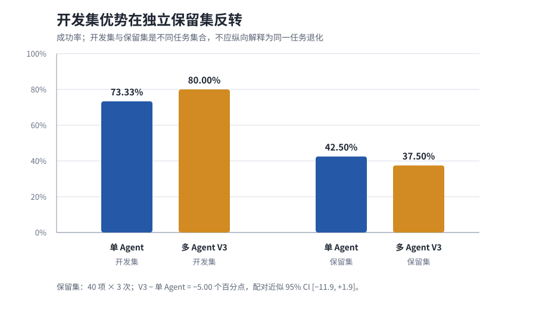

# 多 Agent 的开发集优势没有泛化：ServiceFlow 阶段 5 最终评测摘要

> 结果冻结于 2026-11-21；本报告由 `scripts.build_phase5c_report` 从已冻结结果生成，未重跑 holdout，未调用外部模型。

## 执行摘要

- 在 40 个 τ-bench Retail test 任务、每任务 3 次的配对保留集上，单 Agent 为 **51/120（42.50%）**，多 Agent V3 为 **45/120（37.50%）**。
- V3 相对单 Agent 为 **-5.00 个百分点**；配对近似 95% 区间为 **-11.9 至 1.9 个百分点**，McNemar 精确双侧 `p=0.238`。证据不支持 V3 优越，也不足以证明确定劣势。
- 开发集的单 Agent / V3 为 **73.33% / 80.00%**；到保留集分别下降 **-30.83 / -42.50 个百分点**。开发集优势发生反转。
- 自建可靠性轨道为 **10/10**，但每个场景只执行 1 次且不用外部 LLM；它只证明列出的确定性断言，不等于“系统可靠率 100%”。



## 四组证据矩阵

| 组别 | 证据与样本 | 实际结果 | 可与官方保留集直接比较 | 关键限制 |
| --- | --- | --- | --- | --- |
| `rules` | ServiceFlow 确定性政策与安全路径（自建可靠性轨道）；10 个自建场景，每场景执行 1 次 pytest | 10/10 通过；已断言的违规计数均为 0 | 否 | 不是隔离的官方任务端到端实验臂，且没有重复运行。 |
| `single_agent` | 冻结的 τ-bench Retail test 任务 + DeepSeek 自定义语义 Judge；40 项任务 × 3 次 = 120 次配对运行 | 51/120 (42.50%) | 是 | 自定义 Judge 结果不是官方默认 τ-bench 分数。 |
| `multi_agent` | 冻结的 V3 确定性 Supervisor + 专业角色；40 项任务 × 3 次 = 120 次配对运行 | 45/120 (37.50%) | 是 | V3 的产品边界是一笔订单一个线程。 |
| `multi_agent_recovery` | REL-008 超时归一化与幂等重试断言；1 个自建恢复场景 × 1 次执行 | 1/1 通过 | 否 | 没有执行完整的恢复增强官方任务实验臂。 |

`eval_config.json` 预设了四组，但实际没有形成四组同口径正式对照。只有单 Agent 与多 Agent V3 拥有相同任务、trial、seed、模型、工具、Guard 和预算下的 120 对结果；规则流程与恢复增强只能作为自建工程可靠性证据。

## 官方任务对照

| 指标 | 单 Agent | 多 Agent V3 | 解释 |
| --- | ---: | ---: | --- |
| 成功 / 运行 | 51 / 120 | 45 / 120 | 120 对 trial，seed mismatch 为 0 |
| 成功率 | 42.50% | 37.50% | V3 − 单 Agent = -5.00 个百分点 |
| 延迟 P50 | 27.21 s | 27.84 s | 墙钟时间，含模型与模拟器 |
| 延迟 P95 | 37.79 s | 40.48 s | 不推断并发吞吐；两组均单并发 |
| 工具调用覆盖 | 117/120 | 120/120 | 单 Agent 任务 5 的 3 条完整轨迹丢失 |
| 跟踪 token | 8,874,001（117 次） | 8,255,739（120 次） | 覆盖不同，不能直接用总量判断效率 |
| 跟踪成本 | $0.8917 | $0.9068 | 均不含 Judge；单 Agent 还缺 3 次 usage |

配对结果：双方成功 39，仅单 Agent 成功 12，仅 V3 成功 6，双方失败 63。这比只看两个边际成功率更直接：单 Agent 独占成功对数是 V3 的两倍（12 对 6）。

### 可比 token 与成本子集

为避免把单 Agent 任务 5 的缺失 usage 当成 0，两组都排除任务 5，仅比较各 117 次完整记录：

| 指标 | 单 Agent | 多 Agent V3 | V3 相对变化 |
| --- | ---: | ---: | ---: |
| 每次 token | 75,846.2 | 67,906.9 | -10.47% |
| 每次跟踪成本 | $0.00762 | $0.00748 | -1.80% |

这些仍不是 Provider 最终账单：语义 Judge、未持久化失败请求均未计入。

## 失败分类

失败使用两个互补维度，不把终止原因冒充根因。

### 终止原因

| 架构 | `user_stop` | `max_steps` | 检查点丢失且仅控制台恢复 | 合计 |
| --- | ---: | ---: | ---: | ---: |
| 单 Agent | 49 | 19 | 1 | 69 |
| 多 Agent V3 | 57 | 18 | 0 | 75 |

### 业务动作结果

| 架构 | 必需动作未执行 | 必需动作执行但评分失败 | 执行了不同动作 | 纯沟通/只读失败 | 轨迹不可用 | 合计 |
| --- | ---: | ---: | ---: | ---: | ---: | ---: |
| 单 Agent | 37 | 27 | 3 | 1 | 1 | 69 |
| 多 Agent V3 | 42 | 22 | 10 | 1 | 0 | 75 |

“必需动作执行但评分失败”只能说明至少调用了同名效果工具；参数、最终数据库状态或沟通信息仍可能不满足评分条件。更细的因果解释需要逐轨迹人工审阅，不能从工具名自动推出。

详细复现、根因边界与回归证据见 [`failures/phase5c_failure_catalog.md`](failures/phase5c_failure_catalog.md)。

## 可靠性轨道

10 个自建场景均通过；断言记录中的越权披露、未确认写入、重复写入、政策违规、提案绑定违规、陈旧写入、不支持写入和提示注入成功次数均为 0。`REL-008` 的超时归一化与幂等重试为 1/1。

这组证据的适当结论是“这些已绑定 pytest 的确定性边界在本次执行中通过”，不是对任意自然语言、未知故障或生产负载的统计可靠率估计。

## 决策

1. 保留多 Agent 架构作为工程能力与可解释分工方案，但不宣称它提升了本次任务成功率。
2. 默认产品路线应把单 Agent 保留为统一基线；任何 V4 都必须在新的开发证据和独立未见测试集上重新比较。
3. 优先处理会话停滞、工具预算耗尽和多工具调用被拒后的循环，因为它们与大量 `user_stop` / `max_steps` 失败一致；这是一项待验证假设，不是由终止标签直接证明的根因。
4. 继续把身份、归属、确认、规则、事务和幂等放在服务端确定性层，不以 benchmark 分数替代安全回归。

## 可复现命令

```powershell
# 只读取冻结结果并检查生成物，无外部模型调用、无数据库写入
.\.venv_tau\Scripts\python.exe -m scripts.build_phase5c_report --check

# 求职演示摘要（同样只读）
.\.venv_tau\Scripts\python.exe -m scripts.demo_phase5c
```

结构化分析见 [`phase5c_analysis.json`](phase5c_analysis.json)。原始逐次轨迹位于被 Git 忽略的 `reports/raw/`，避免提交模拟客户明细；可提交结果只包含聚合统计、任务 ID 和去标识化复现说明。
